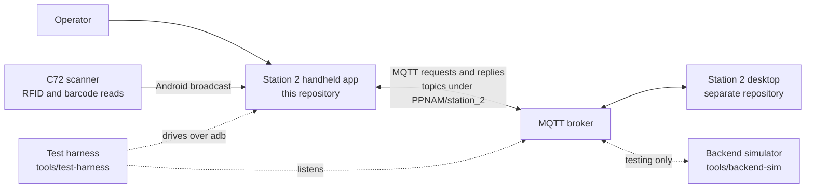

<div align="center">


<h1>PPNAM Station 2 Handheld App</h1>

<p>
The Android app that mixing operators at PPNAM Station 2 carry on a Chainway C72 handheld.<br>
It looks up a job card, guides the operator through collecting each ingredient from its pallet by scanning the pallet tag,<br>
and starts and finishes each mix on a mixer. Every scan is checked by the Station 2 desktop.
</p>

<p>

&nbsp;&nbsp;&nbsp;&nbsp;&nbsp;&nbsp;
<picture>
  <source media="(prefers-color-scheme: dark)" srcset="docs/assets/systems-one-dark.png">
  
</picture>
</p>

<p>
<a href="https://github.com/Systems-One/PPNAM_Station_2_AA/releases/latest"><b>Latest release (APK)</b></a>
&nbsp;|&nbsp;
<a href="#documentation"><b>Documentation</b></a>
&nbsp;|&nbsp;
<a href="docs/sop/PPNAM_Station_2_Handheld_SOP.pdf">Operator SOP (PDF)</a>
&nbsp;|&nbsp;
<a href="docs/TEST_PLAN.md">Test plan</a>
&nbsp;|&nbsp;
<a href="tools/backend-sim/README.md">Backend simulator</a>
</p>

</div>

## Contents

- [What it does](#what-it-does)
- [What the system can do](#what-the-system-can-do)
- [How it fits together](#how-it-fits-together)
- [Status](#status)
- [Get started](#get-started)
- [Install on a handheld](#install-on-a-handheld)
- [Documentation](#documentation)
- [Repository layout](#repository-layout)

## What it does

The app runs on the Chainway C72 handheld in the mixing area. An operator signs in, looks up a job card, and the app tells them which pallet to take from and how much. Each bag is recorded when the pallet tag is scanned. The Station 2 desktop decides whether every scan is accepted and keeps the job, the stock and the history; the handheld shows the answer.

- Prepare one or more mixes for a job card (Production Order) and collect every ingredient for them.
- Start and finish each mix, and production on routes with an extruder, by scanning the machine's code.
- Collect a whole job card on the Rajoo machine in one or more sessions.
- Hold the operator back and offer **Retry** when Station 2 has not answered, so nothing is recorded twice.

What it does not do, as stated in the operator SOP: it does not weigh anything, it does not move stock in SAP or print, and it cannot undo a recorded bag. Those are done on the Station 2 desktop.

## What the system can do

### Handheld app

Built and released (v1.0.0, version code 13). The repository holds 765 unit tests in 68 test files (counted in the source, not run for this README). The last recorded test run on a real handheld was on 28 October 2026 against an earlier build; see [Status](#status).

| Area | Capability |
|---|---|
| Sign-in | Username and password, or an RFID badge scan. The username can be picked from a list when Station 2 sends one. |
| Automatic sign-out | Signs the operator out after 15 minutes without a touch or scan. A supervisor can change the time; 0 means never. |
| Connection status | A status pill on every screen: Connected, Reconnecting, Station 2 offline, Clock out of sync, Offline. |
| Job cards | Look up a job card and see its mixes, progress and materials. |
| Preparing mixes | Create a preparation of one or more mixes, with an Include or Exclude choice for listed ingredients. |
| Collecting ingredients | Shows which pallet to take from and how much, and records each bag against the preparation when the pallet tag is scanned. |
| Changes during collection | Add an ingredient that is not in the mix, or change an ingredient, with a reason. |
| Pallets that cannot be used | Shows why a pallet was refused (for example blocked or excluded) so the operator can fetch another. |
| Mixing and production | Start and finish each mix, and production where the route has an extruder, by scanning the machine's code. |
| Rajoo | Collect against the job card's full targets in sessions, and close the job card when all material is collected. |
| Unanswered commands | A command Station 2 has not answered is kept on the handheld and shown on Home with **Retry**, so the same bag is not sent twice. |
| Scan feedback | Sounds and vibration for scan results. |
| Settings | Diagnostics for anyone (broker link, Station 2 state, version, device ID). Broker settings, sign-out time and request timeout behind a supervisor PIN, with a lock-out after five wrong attempts. **Test & Apply** saves the settings only if the connection works. |
| Device identity and credentials | The device ID is derived from the hardware, not typed in. The broker password is stored encrypted on the handheld and has no built-in default. |
| Screen | Portrait only. |

### Backend simulator

Built and tested. Its in-process self-test passed all 384 checks when run for this README (27 November 2026).

| Area | Capability |
|---|---|
| Stand-in for Station 2 | Answers the app over MQTT so the app can be tested end to end without the real Station 2 desktop. |
| Requests covered | Password and badge login, and the General and Rajoo actions listed in the [simulator README](tools/backend-sim/README.md). |
| Demo data | A repeatable in-memory world: demo operators, three job cards (one of them Rajoo) and tagged pallets, including blocked and off-recipe pallets. |
| Logs | Every message, validation step, decision and state change is logged per run. |
| Fault injection | Control messages can drop a request, drop a reply or change the station's presence, to test retry and recovery. |

### Delivery

Built; one release has been published by it.

| Area | Capability |
|---|---|
| Release build | Pushing a `v*` tag builds the APK on GitHub Actions and publishes it as a GitHub Release, named `PPNAM_Station_2_AA.apk`. |
| Signature check | The build fails if the APK is not signed with the shared PPNAM keystore, because a different signature would break updates on handhelds that already have the app. |
| Manual build | A manually started run builds the APK as a workflow artifact without releasing it. |
| Operator SOP | The SOP is generated as one self-contained HTML file and an A4 PDF from [docs/sop/content.md](docs/sop/content.md). |

## How it fits together



The handheld publishes each request on its own request topic and listens on its own reply topics and on the station's presence topic. The Station 2 desktop is not in this repository.

| Part | What it does | Folder |
|---|---|---|
| Handheld app | The Android app: screens, scan handling, sign-in, MQTT messaging, the store of unanswered commands. | [app/](app/) |
| App unit tests | Unit tests and the contract sample messages they check against. | [app/src/test/](app/src/test/) |
| Backend simulator | Python stand-in for the Station 2 desktop, with its own self-test. | [tools/backend-sim/](tools/backend-sim/) |
| Test harness | Python scripts that listen to the broker, drive the app's screens over adb and send fault-injection commands to the simulator. | [tools/test-harness/](tools/test-harness/) |
| Operator SOP | The SOP text, screenshots, generator and the built HTML and PDF. | [docs/sop/](docs/sop/) |
| Release workflow | Builds, checks and publishes the APK. | [.github/workflows/](.github/workflows/release.yml) |

## Status

| Part | State |
|---|---|
| Handheld app | Released as v1.0.0 (version code 13) on 26 November 2026. This is the only tag and the only GitHub Release. Earlier versions in the commit history ran from 1.0 up to 1.5.3 and 2.0.0 before the version name was set back to 1.0.0. |
| Unit tests | 765 tests in 68 files by source count. They were not run for this README, so their current pass state is not stated here. There are also 2 instrumented (on-device) tests. |
| On-device testing | Last recorded run: 28 October 2026 on v1.4.1 (7) against the live Station 2. Of 166 cases, 115 passed, 5 failed, 45 were blocked (they need the simulator, broker access, a second device or the desktop) and 1 was not applicable. The failures and other defects are listed in the [run report](docs/test-runs/2026-10-28/report.md). No later run is recorded, so this repository does not show whether those findings are fixed in v1.0.0. |
| Backend simulator | Self-test: all 384 checks passed on 27 November 2026. Its README describes contract revision 2026-10-21, while the app's code names revision 2026-11-17. |
| Operator SOP | Written for app version 1.5.0 (dated 6 November 2026). It has not been reissued for v1.0.0. |
| Test plan | [docs/TEST_PLAN.md](docs/TEST_PLAN.md) predates the current message contract: it still refers to message schema 4.0, 29 test classes and a 109-check simulator self-test. |
| CI | One workflow, for releases only. Nothing runs the unit tests or lint automatically. |

## Get started

You need:

- JDK 17 (the release workflow builds with Temurin 17) and the Android SDK for API level 35.
- Python 3 with `paho-mqtt` for the simulator (`pip install -r tools/backend-sim/requirements.txt`).
- A Chainway C72 or an emulator to run the app. The minimum Android version is 8.0 (API 26).

Build the debug APK (the same task the release workflow runs) and run the unit tests:

```bash
./gradlew assembleDebug
./gradlew test
```

Run the simulator's self-test. It runs in-process and needs no broker:

```powershell
cd tools\backend-sim
python selftest.py --direct
```

> [!WARNING]
> `python sim.py` with no options connects to the shared broker `mqtt.sysone.co.za` and announces itself as Station 2. If the real Station 2 is online on that broker, both will answer every request from every handheld. Pass `--yield-to-real` to make the simulator exit instead, or run it against a private local broker as described in the [simulator README](tools/backend-sim/README.md). The scripts in [tools/test-harness/](tools/test-harness/) also connect to the shared broker by default and drive whichever handheld is attached over adb.

## Install on a handheld

1. Open the [latest release](https://github.com/Systems-One/PPNAM_Station_2_AA/releases/latest) and download `PPNAM_Station_2_AA.apk`.
2. Install the APK on the Chainway C72. This repository does not document the install procedure for handhelds.
3. Open the app. On a new handheld the status pill is red (**Offline**) because no broker account is set up yet.
4. Tap the gear, enter the supervisor PIN and tap **Unlock**.
5. Fill in the broker **Host** and **Port** (normally `mqtt.sysone.co.za` and `443`, with **WebSocket** and **TLS** on) and the broker **Username** and **Password** for this handheld.
6. Tap **Test & Apply**. The settings are saved only if the connection works.
7. Wait for the status pill to show **Connected**, then sign in.

The operator SOP covers everything after this point.

## Documentation

| I want to | Read |
|---|---|
| Learn how to use the app as an operator or supervisor | [Operator SOP (PDF)](docs/sop/PPNAM_Station_2_Handheld_SOP.pdf) or [HTML](docs/sop/PPNAM_Station_2_Handheld_SOP.html) |
| Edit the SOP text | [docs/sop/content.md](docs/sop/content.md) |
| Rebuild the SOP after editing it | [docs/sop/_template/README.md](docs/sop/_template/README.md) |
| Test the app without the real Station 2 | [tools/backend-sim/README.md](tools/backend-sim/README.md) |
| Run a full test pass | [docs/TEST_PLAN.md](docs/TEST_PLAN.md) (see the note under [Status](#status)) |
| See the test case matrix | [docs/test-matrix/](docs/test-matrix/) |
| See the latest on-device test results | [docs/test-runs/2026-10-28/report.md](docs/test-runs/2026-10-28/report.md) |
| See earlier test runs | [23 July](docs/test-runs/2026-07-23/report.md), [27 July](docs/test-runs/2026-07-27/report.md) and [30 July 2026](docs/test-runs/2026-07-30/report.md); the 24 July folder holds [message captures only](docs/test-runs/2026-07-24/) |
| Read the first live test report (23 July 2026) | [docs/TEST_REPORT_2026-07-23.md](docs/TEST_REPORT_2026-07-23.md), with its [findings log and evidence](docs/test-evidence-2026-07-23/FINDINGS.md) |
| See the app issues found in that test | [docs/ANDROID_APP_ISSUES_2026-07-23.md](docs/ANDROID_APP_ISSUES_2026-07-23.md) |
| See the Station 2 backend issues found in that test | [docs/BACKEND_ISSUES_2026-07-23.md](docs/BACKEND_ISSUES_2026-07-23.md) |
| Read the request to Station 2 about the timestamp acceptance window | [docs/backend/2026-07-16-timestamp-acceptance-window.md](docs/backend/2026-07-16-timestamp-acceptance-window.md) |
| Understand why a feature was designed the way it was | [docs/superpowers/specs/](docs/superpowers/specs/) (design documents, by date) |
| See how a feature was planned for implementation | [docs/superpowers/plans/](docs/superpowers/plans/) (implementation plans, by date) |
| See the contract sample messages the unit tests check against | [app/src/test/resources/contract/](app/src/test/resources/contract/) |
| See how a release is built | [.github/workflows/release.yml](.github/workflows/release.yml) |
| Read an early fix report from development | [.superpowers/sdd/final-fix-report.md](.superpowers/sdd/final-fix-report.md) |
| Know the rules for AI coding assistants in this repository | [CLAUDE.md](CLAUDE.md) |

## Repository layout

| Folder | What is in it |
|---|---|
| [app/](app/) | The Android app (Kotlin, Jetpack Compose), its unit tests and its two instrumented tests. |
| [assests/](assests/) | Source artwork: the mixer icon and the PPNAM and MITAS logo files. The folder name is spelled this way in the repository. |
| [docs/](docs/) | The operator SOP, test plan, test matrix, test run reports and evidence, issue lists, and design and plan documents. |
| [docs/assets/](docs/assets/) | The images this README uses. |
| [tools/](tools/) | The backend simulator and the test harness scripts. |
| [gradle/](gradle/) | The Gradle wrapper and the dependency version catalogue. |
| [.github/](.github/workflows/release.yml) | The release workflow. |
| [.agents/](.agents/), [.claude/](.claude/), [.superpowers/](.superpowers/) | Settings, skills and notes for AI coding assistants. |
